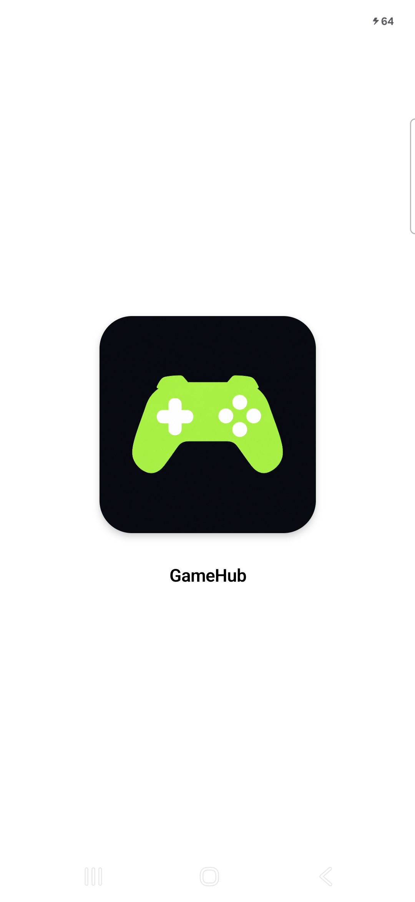
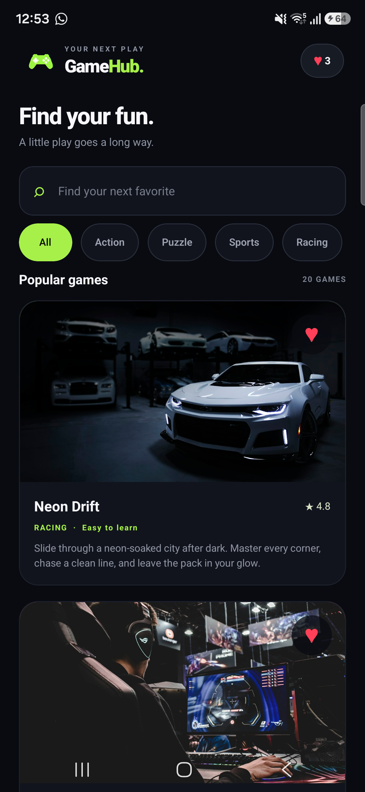
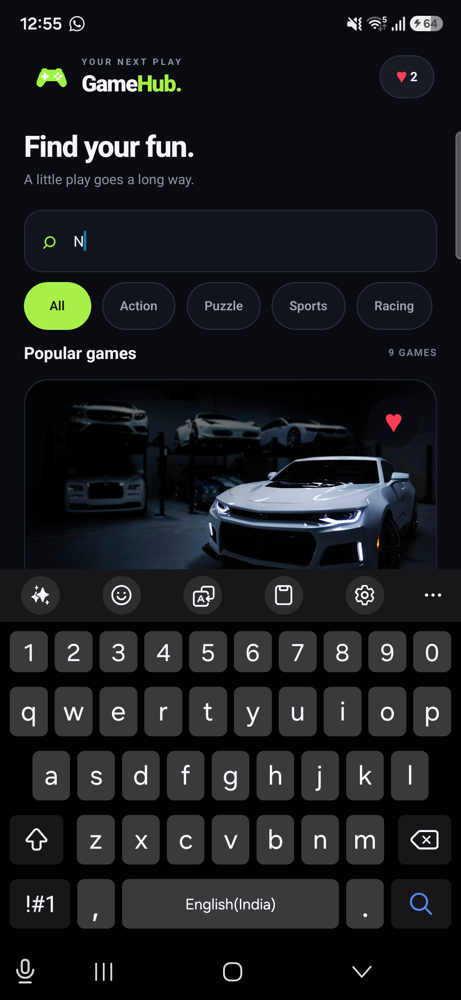
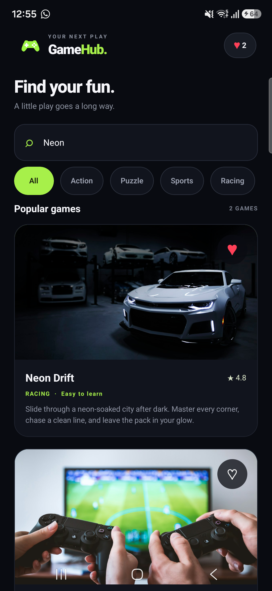
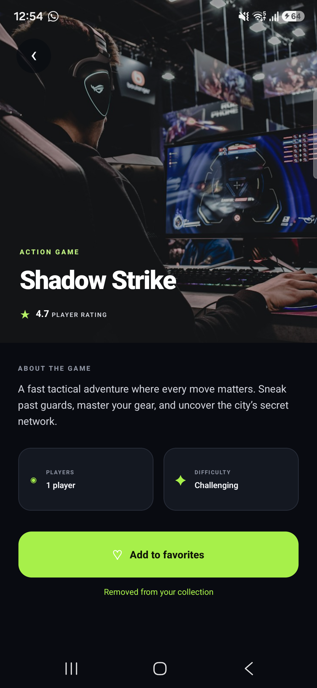
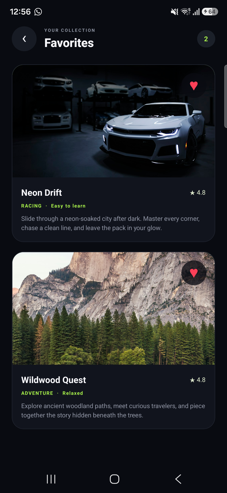
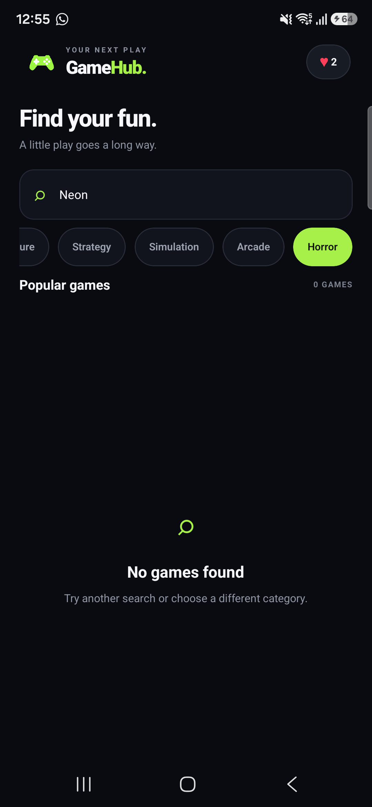

# GameHub

GameHub is an Expo and React Native game discovery app. Browse a local mock catalog, search by game name, filter by category, view game details, and save a personal favorites list.

## Features

- Home screen with a searchable game list rendered with `FlatList` and stable game IDs.
- Horizontal category filters: All, Action, Puzzle, Sports, Racing, Adventure, Strategy, Simulation, Arcade, and Horror.
- Horror is intentionally empty and shows the no-results state.
- Game details with artwork, category, rating, description, player count, and difficulty.
- Favorites shared across screens with Zustand and persisted locally with AsyncStorage.
- Loading, error, empty-results, and missing-image fallback states.
- Dark gaming theme with lime accents.

The local catalog contains 20 games. Category counts are: Action 3, Puzzle 3, Sports 2, Racing 2, Adventure 2, Strategy 2, Simulation 2, Arcade 4, and Horror 0. All contains the complete catalog.

## Technology

- Expo SDK 54, React Native 0.81, React 19, and TypeScript.
- React Navigation native stack.
- Zustand for shared favorites state and AsyncStorage for persistence.
- Local JSON mock data; no backend or remote catalog API.
- `expo-image` for game artwork and its error fallback.

## Requirements

- Node.js 20.19.4 or newer (Expo SDK 54 requirement).
- pnpm 9 or newer.
- Expo Go on an Android or iOS device, or an Android Studio/iOS simulator appropriate to your development machine.

## Install and run

From the project root:

```sh
pnpm install
pnpm start
```

Scan the Expo QR code with Expo Go, or press `a` to open an Android emulator. The project also defines `pnpm android`, `pnpm ios`, and `pnpm web` scripts. For a physical device, keep it and the development computer on the same network. If local discovery is blocked, use:

```sh
pnpm exec expo start --tunnel
```

## Source structure

```text
App.tsx                         Navigation container and app theme
index.ts                        Expo entry point
assets/                         App icon and branding assets
src/
  components/                   Reusable artwork, cards, filters, search, and empty state
  data/
    games.json                  Editable local mock catalog
    games.ts                    Catalog validation and data access
  screens/                      Home, Details, and Favorites screens
  store/favorites.ts            Shared favorites state and persistence
  types.ts                      Game, category, and navigation types
```

## Favorites and data behavior

The catalog in `src/data/games.json` is validated at the data boundary and exposed through `src/data/games.ts`. Home and Favorites consume the same catalog. The Details screen looks up a game synchronously by its stable ID.

Favorite IDs live in a Zustand store and are saved to AsyncStorage. Hydration status prevents favorite interaction before saved state is restored; storage errors are handled by the existing store behavior. AsyncStorage is local to the app installation and is not synchronized between devices.

Artwork URLs point to Unsplash, so images need an internet connection. The game list itself is local. When an image is missing or fails to load, `GameArtwork` displays a colored initial instead.

## Validation available

```sh
pnpm typecheck
pnpm exec expo config --type public --json
```

The project does not currently define a dedicated lint command or automated test runner. The commands above are checks, not a substitute for testing the interactions on a device.

## Manual verification checklist

1. Launch Home and confirm games render; check a game card's title, category, rating, and artwork.
2. Search for a partial game name, then a term with no matches.
3. Select All and each category. Confirm Horror shows the empty-results state.
4. Search while a category is selected, then clear the search and confirm the selected category's full results return.
5. Open multiple cards and confirm each Details screen shows the selected game's data; use back navigation.
6. Add and remove favorites from Home, Details, and Favorites. Confirm the count and controls stay synchronized.
7. Force-close and reopen the app to check that favorites remain saved. Remove all favorites and check the empty state.
8. Temporarily use a validly formatted but unreachable image URL in a local test, then restore the catalog and check the colored-initial fallback.
9. Check search with the keyboard visible and scroll the list with the keyboard dismissed.

## Screenshots for submission

The following screenshots are present in `screenshots/`.

### Launch screen



### Home



### Search





### Game Details



### Favorites



### Empty Results



## Limitations

- Games are mock data; there is no backend, account, or cross-device sync.
- Artwork depends on external Unsplash URLs and network availability.
- The empty Horror category is intentional sample behavior.
- The included screenshots document representative app states.
